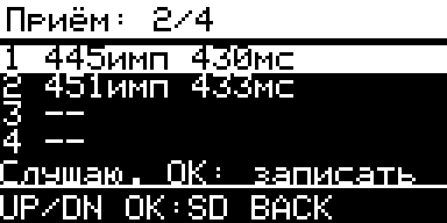

# Передача файла и приём сигнала

## Передать файл

Откройте **Радио SubGHz → Файлы .sub**, выберите файл и пункт
**Отправить**. Удерживайте OK для одной передачи. BACK прерывает передачу.

Частота берётся из строки `Frequency` выбранного файла. Менять её в настройках
приёма заранее не требуется. На время передачи применяются частота и
поддерживаемый радиопрофиль файла; затем восстанавливаются прежние настройки
экрана и самого CC1101. Возврат выполняется также после отмены или ошибки.
Повторная отправка требует нового удержания OK.

Поддерживаемые аппаратные диапазоны CC1101: 300–348, 387–464 и 779–928 МГц.
Частоты в промежутках между ними не поддерживаются. Поправка конкретного
модуля применяется отдельно; если она выводит частоту за аппаратный диапазон,
передача отклоняется. Частота в исходном файле не изменяется.

Для файла действуют ограничения 2048 интервалов и 5 секунд. Передаются
двоичный OOK RAW и поддерживаемые статические протоколы RcSwitch protocol 1,
Princeton и CAME. Наличие допустимой частоты не добавляет кодировщик для
других протоколов. Динамические протоколы доступны для просмотра метаданных.
Автоматическая настройка частоты файла применяется отдельно от каналов чата.

## Принять и сохранить

В **Настройках приёма** выберите частоту и тип сигнала отправителя, затем
откройте **Принять сигнал**. Для обычного Princeton с Flipper используются
433.920 МГц и AM/OOK 270 кГц.

Дождитесь завершения короткой подготовки по фоновому шуму, затем передайте
сигнал с Flipper или нажмите кнопку пульта. Простой режим сам выбирает порог
записи и собирает список до четырёх сигналов. UP/DOWN выбирают строку,
OK сохраняет выбранную запись на SD в `/subghz/LabRAW_XXXX.sub`.

Реальный экран устройства с двумя принятыми сигналами:

Принимайте целую пачку RAW-сигнала вместе с необходимыми повторами.
Обрезанный фрагмент или один неполный период может не приниматься целевым
устройством, даже если файл удалось сохранить.

После сохранения приём ставится на паузу; остальные записи остаются в списке,
и их тоже можно сохранить. При заполнении четырёх мест список не перезаписывается.
Удерживайте OK и подтвердите очистку, чтобы начать новый список. BACK выходит;
если есть несохранённые записи, появится подтверждение. Удержание BACK явно
подтверждает выход. История этого сеанса очищается после выхода, сохранённые
файлы на SD остаются.

Простой список слушает до заполнения, паузы или выхода. Повторы сопоставимых
RAW-волн объединяются по частоте, числу интервалов и допуску их длительности;
это не распознавание всех протоколов. Записи с разной структурой могут остаться
отдельными строками. Каждый элемент ограничен 2048 интервалами.

Частота и модуляция приёмника должны соответствовать отправителю:
автоматический порог не определяет их по радио. Полные настройки с ручным
порогом и записью одного RAW-сигнала доступны в **Дополнительно**.

При переполнении банка, потере интервалов или ошибке радио повреждённая запись
не сохраняется как исправный файл. Сократите передачу и повторите приём.
Запись RAW сохраняет форму сигнала и не означает поддержку его протокола
декодером или возможность передачи динамического кода.

## Что проверено на устройстве в `.3`

На исходниках `9b93f08` проверен настоящий путь **Flipper → история ESP32 →
SD → повторное чтение RAW → Flipper**. После 64 фоновых измерений история
оставалась пустой до передачи. Два тестовых Princeton-кода A53A53 и A53B53
с десятью повторами, TE 390 мкс и Guard_time 30 заняли разные строки:
445 и 451 интервал. Обе записи сохранились на SD.

Одна явно запрошенная передача сохранённого второго файла заняла 433 963 мкс;
Flipper действительно декодировал A53B53 и сообщил о четырёх пакетах.
Проверка возврата 45 регистров CC1101, PA-таблицы и прежнего RX/IDLE прошла,
сбоев не было. Это проверка конкретных полных OOK-пачек, а не обещание работы
всех протоколов. Радиообмен через Enhanced Chat GUI не проверялся.
