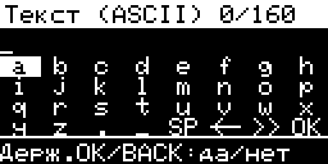

# Экранная клавиатура ESP32

В полях ввода теперь видна сетка **8 × 4**: символы, выбранная клавиша и
действия. Сверху показаны последние 20 символов текста и счётчик длины.
Клавиатура использует четыре существующие кнопки устройства.

Это изображение получено из буфера настоящего OLED после прошивки, а не макет.

| Кнопка | Действие |
|---|---|
| UP / DOWN | Предыдущая / следующая клавиша; выбор идёт по строкам и замыкается по кругу. |
| OK | Ввести выбранный символ или выполнить выбранное действие. |
| BACK | Стереть последний символ. |
| Удерживать UP / DOWN | Предыдущая / следующая страница символов. |
| Удерживать OK | Завершить ввод и принять текст. |
| Удерживать BACK | Отменить ввод. Исходное значение поля сохраняется. |

Последние четыре клавиши сетки:

- **SP** — пробел, если он разрешён в этом поле.
- **<-** — стереть последний символ.
- **>>** — следующая страница.
- **OK** — завершить ввод.

Под сеткой показана подсказка для выбранного действия. Недоступное действие
перечёркнуто: например, пробел в имени файла или переход страницы в коротком
цифровом наборе. Пустые клетки при перемещении пропускаются. Если поле
заполнено, появится сообщение «Поле заполнено»; последний доступный символ
не перезаписывается.

Обычный текст имеет страницы со строчными латинскими буквами, прописными
буквами, цифрами и знаками. Поля частоты, HEX и имени файла показывают только
свой разрешённый набор. Ввод остаётся **ASCII**: русские подписи интерфейса
не добавляют кириллицу в радиопротокол чата. Допустимая длина определяется
конкретным полем; текст чата — до 160 символов.

Для сообщения откройте **Радио SubGHz → Чат Flipper → OK → Написать текст**.
В этом обычном меню завершение непустого текста ставит его в очередь на
отправку. Отмена ничего не отправляет. Ограничения радиопередачи и проверка
занятого канала продолжают действовать.

Для проверки экрана через USB команда `chatedit` только в уже открытом активном
чате запрашивает отдельный просмотр редактора. Команда не открывает окно внутри
обработчика UART: его открывает основной цикл чата после возврата обработчика.
В этом проверочном окне черновик всегда отбрасывается, даже при завершении
ввода; радиосообщение не ставится в очередь. Команда `screen` читает изображение
экрана, а `chatclose` закрывает редактор и чат. Повторный `chatedit` во время
любого уже открытого редактора отклоняется.

Модель клавиатуры проверена на хосте: 1 460 550 проверок под Zig и GCC, включая
ограниченные наборы, границы буферов, отмену и смену страниц. Фактические функции
редактора и UART-контроллера прошли ещё 2 429 проверок с подменой кнопок,
экрана и радио. Эти автоматические проверки не заменяют просмотр OLED на
устройстве.

На подключённом ESP32 после записи сборки `087f9b6` редактор действительно
отобразился на OLED. Проверочное окно закрылось отменой, счётчик передачи
оставался нулевым, перезапуска не было; главное меню восстановилось.
